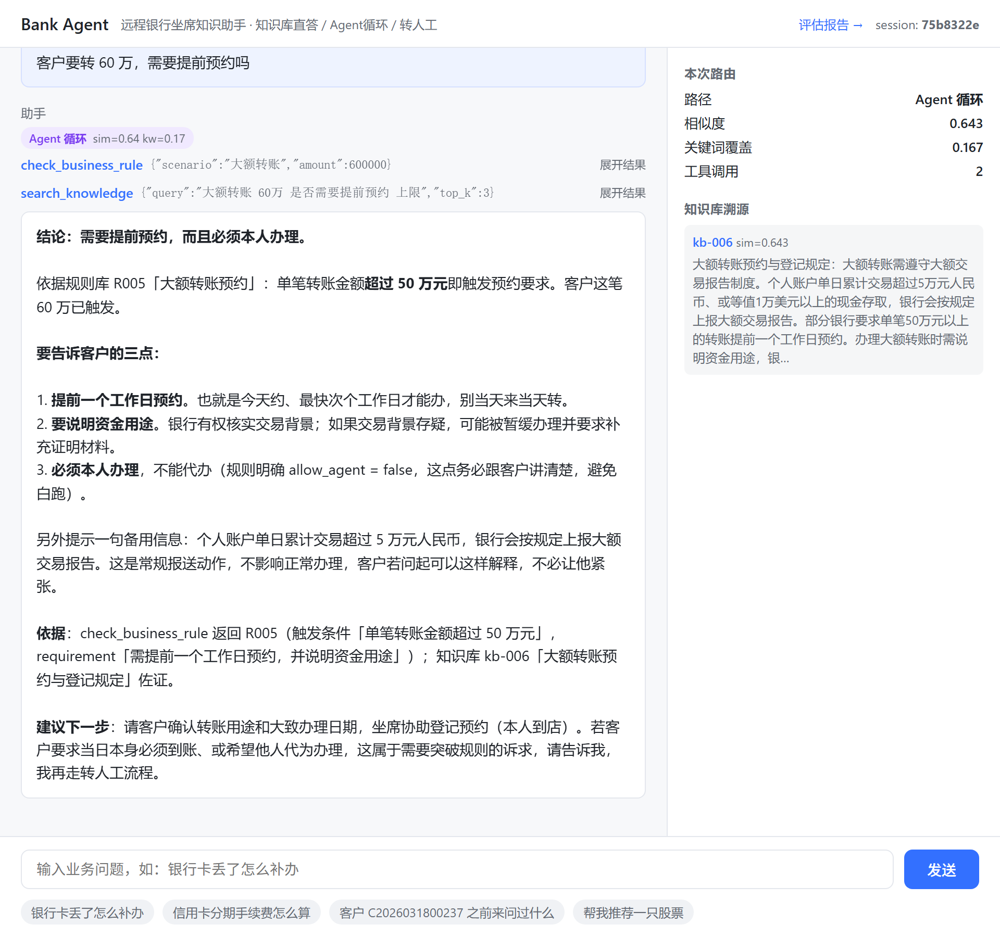
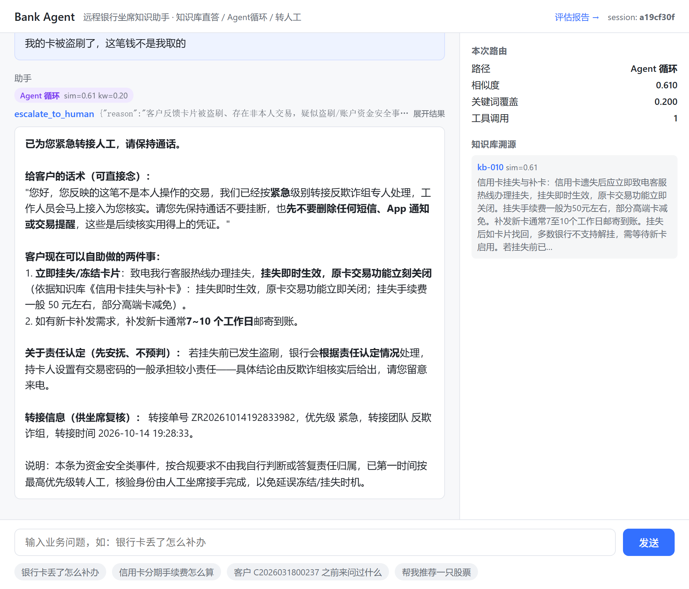
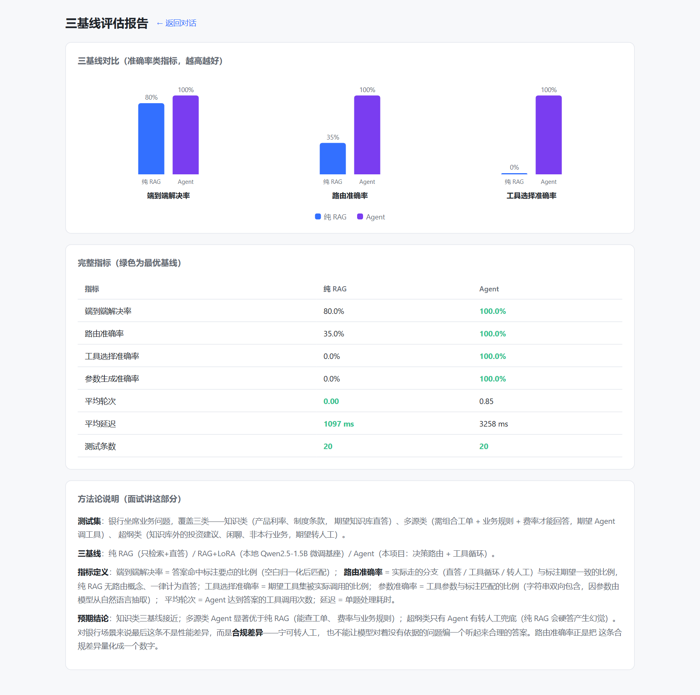

# Bank Agent · 银行远程银行坐席知识助手

把 **RAG 检索置信度从「相关度分数」升级为「决策路由信号」** 的企业级 Agent 作品。

面向银行远程银行中心（客服坐席 / 网点柜员），解决一个很具体的业务问题：
**坐席接电话时要在几秒内答出准确的业务规则，答错就是事故，编造就是违规。**

> 本作品是 `ops-agent`（企业 IT 运维智能体）的**同构换皮**：编排骨架（三级置信度路由 +
> ReAct 工具循环 + 双编排引擎）完全复用，替换的是知识库、工具集、业务数据与全部话术。
> 换皮方法论见 [从 ops-agent 到 bank-agent](#从-ops-agent-到-bank-agent同构替换)，
> 场景选型依据见 [`docs/场景设计.md`](docs/场景设计.md)。

## 实跑截图



**这张图里值得看的四处细节**（实跑截图，非示意图）：

1. **路由徽章 `Agent 循环 sim=0.64 kw=0.17`** —— 置信度落在中区间，被判进受控工具循环，而不是硬答。
2. **两次工具调用**：`check_business_rule(scenario="大额转账", amount=600000)` 查规则表拿到
   逐条判定，再 `search_knowledge` 补制度依据 —— 这正是通用 RAG 做不到的部分。
3. **答案给了依据**（引用 R005 与 kb-006），不是一段没有出处的漂亮话 —— 可溯源是银行场景的硬要求。
4. **右侧溯源面板**列出命中的知识片段与相似度，坐席可以复核。

> 问「客户要转 60 万，需要提前预约吗」而不是问「大额转账要预约吗」是有意的：
> 后者知识库就能答；前者**带具体金额，必须落到业务规则表的逐条判定**。

### 资金安全类请求：路由层强制转接（第 5 个工具真的会被调用）



**这张图是「升级人工」这条设计的实跑证据**（实跑截图，非示意图）：

1. **路由徽章 `Agent 循环 sim=0.61 kw=0.20`** —— 客户说"盗刷"，制度文档里没有这种话术，
   相似度只有 0.61、关键词覆盖 0.20，本来会被低置信兜底成"超出知识库范围"。
2. **工具调用 `escalate_to_human`，参数是设计值**：`priority="紧急"`、`suggested_team="反欺诈组"`
   —— 这两个值不是模型自己猜的，是路由层按资金安全档注入的指令。
3. **答案里没有向客户追问账号**，反而先给出"立刻挂失 / 别删短信和 App 通知"等自助动作，
   并附上可复核的转接单号 —— 这正是"AI 环节不追问身份，核验交给人工坐席"的设计意图。
4. **右侧溯源面板**同时给出 kb-010（信用卡挂失与补卡），说明转接不等于中止服务。

> 这张图不是为了好看才截的：`escalate_to_human` 曾在**收口审查中被发现是死代码**
> —— 投诉与资金安全类问题在路由层就被拒答话术拦掉了，Agent 根本看不到它们。
> 修复过程（三步，每一步都是被上一步的实测逼出来的）见「升级人工」一节。

<details>
<summary>评估报告页（点击展开）</summary>



</details>

---

## 一、核心设计：置信度路由即合规风控

银行 AI 的硬约束是「**不能幻觉、不能越权、必须可问责**」。
三档路由天然对应银行要求的「**风险分级处置**」——这不是性能优化，是合规机制。

| 路由分支 | 触发条件 | 处置方式 | 合规含义 |
|---|---|---|---|
| `rag_direct` | sim ≥ 0.55 且 kw_coverage ≥ 0.15 | 基于命中条款组织语言，不进 Agent 循环 | 标准业务问题，可直接答复客户，答案可溯源 |
| `agent_loop` | 0.40 ≤ sim < 0.55 | 进受控 ReAct 循环调工具补充信息 | 信息不足，需查工单/费率/规则才能答 |
| `refuse_human` | sim < 0.40 或命中行外护栏 | **不调模型，直接转人工** | 超出知识边界，禁止模型自由发挥 |

> 阈值不是唯一依据。**行外护栏**（合规红线）与**升级人工**（投诉 / 要求人工 / 资金安全）
> 都排在阈值决策**之前**——这两类请求的处置方式与相似度高低无关：
> 荐股不能答就是不能答；客户投诉不管知识库里有没有相关条款，都不该由 AI 答完了事。

### 高置信 ≠ 应当直答（换皮时发现的两个隐蔽坑）

知识库答得了，不等于**该由知识库答**。这两类问题即使 sim 很高，也强制改走 Agent 查结构化表：

| 类型 | 例子 | 为什么不能直答 | 改写路径 |
|---|---|---|---|
| 具体数字 | 「信用卡分 12 期的手续费率是多少」 | 制度文档只给区间「7%~9%」，精确值 **7.20%** 在产品参数表；且挂牌价会调整，凭制度回答等于给过期信息 | `get_product_rate` |
| 条件判定 | 「客户要转 60 万，需要提前预约吗」 | 制度原文口径模糊「部分银行要求…」；逐条判定在业务规则表，且答案随客户具体金额变化 | `check_business_rule` |

### 行外护栏：合规红线优先于任何置信度信号

「帮我推荐一只股票」与知识库里的「基金定投 / 理财风险等级」语义接近，相似度不低，
会被判进 `agent_loop` 并**真的去回答**。但银行无投顾牌照，**不得提供证券投资建议**——
这不是答得好不好的问题，是能不能答的问题。故用显式护栏（`_is_out_of_scope`）硬拦截，
优先级高于所有阈值判断。

### 升级人工：同样是「不该由 AI 处理」，但必须说对话

设计自洽性审查时发现的一个真缺陷：`escalate_to_human` **是死代码**。

投诉类问题实际是这样的——`投诉` / `找人工` / `盗刷` 这些话在制度文档里根本不存在，
所以 sim 只有 0.13~0.33，必然落进低置信兜底，被 `refuse_human` 拦掉：

> 「这个问题超出了当前知识库的覆盖范围（最高相似度 0.21）。……已为您转接人工坐席处理。」

对一个正在投诉的客户说「**您的投诉超出了我们的知识库范围**」是客服事故——
客户要的不是"你答不了"，而是"有人来处理"。同时因为问题在路由层就被拦掉，
Agent 永远看不到它们，那个专门为"我不该自己处理"设计的工具**从未被调用过**。

修复分三步，每一步都是被前一步的实测逼出来的：

| 步骤 | 问题 | 做法 |
|---|---|---|
| ① 上提优先级 | 升级的处置方式不该随 sim 变化，原先只在低置信分支里判，sim 一高就整条绕过 | 把 `_needs_escalation` 提到阈值决策**之前**（与行外护栏同级） |
| ② 上硬约束 | 实测只给提示词时，同一句「我的卡被盗刷了」两次运行**一次转接、一次先追问卡号**（约 50% 服从率） | 用 `tool_choice` 强制 Agent 首轮调用 `escalate_to_human`，把"要不要转"从自由裁量改成确定性行为 |
| ③ 分语境 | 上提后立刻误伤 B16「客户 C… 有没有**投诉**记录」——那是坐席在查档案，不是客户在投诉 | 加检索语境排除（`记录/工单/历史/之前` 且无第一人称主体 → 不算升级） |

升级类内部分两档，**两档都强制转接**，差别收在指令内容里（时效性要求不同）：

| 档位 | 触发例子 | 注入 Agent 的指令 |
|---|---|---|
| 资金安全（紧急） | 「我的卡被盗刷了」「这笔钱不是我取的」 | priority=紧急、转**反欺诈组**、**禁止先追问账户/身份**（核验身份是人工接手后的动作，AI 追问等于让客户空等） |
| 投诉 / 要求人工 | 「我要投诉」「转人工」「服务态度太差了」 | priority=优先、转**客户投诉处理组**、先安抚情绪再说明流程 |

为什么要上硬约束而不是相信模型——因为**误报的收益是不对称的**：
误升 → 客户多接一次人工坐席，成本极低；漏升 → 一次真实的盗刷投诉被当成普通咨询走完流程，
钱可能已经转走了。所以资金安全类：宁可误升，不可漏升。

---

## 二、评估结果（可复现）

测试集：21 条银行业务问题（8 条知识类 / 10 条工具类 / 3 条超纲类），
每题标注期望要点、期望工具与期望路由。

```
python eval.py --baseline all --repeat 3   # 需 DEEPSEEK_API_KEY，约 200 次 LLM 调用
```

| 指标 | 纯 RAG | RAG+LoRA（本地小模型） | **Bank Agent（本项目）** | 说明 |
|---|---|---|---|---|
| 端到端解决率 | 69.8% | 66.7% | **100%** | 答案命中标注要点的比例 |
| **路由准确率** | 33.3% | 33.3% | **100%** | 实际分支与期望分支一致的比例（合规差异的量化） |
| 工具选择准确率 | — | — | **100%** | 期望工具被实际调用的比例 |
| 参数生成准确率 | — | — | **100%** | 工具参数与标注匹配（字符串双向包含） |
| 平均轮次 | 0.00 | 0.00 | 0.79 | Agent 达到答案的工具调用次数 |
| 平均延迟 | 1223 ms | **6152 ms** | 2425 ms | 单题处理耗时（**均值会骗人，必须分路径看** ↓） |
| └ 知识库直答路径 | 1223 ms | 6152 ms | 1517 ms | Agent 在此路径只多 ~0.3s（检索 top_k=3 + 更长的 system prompt） |
| └ 工具循环路径 | — | — | **3350 ms** | 代价全在这里：2~3 次 LLM 往返换「查到真实数据」 |
| └ 转人工路径 | — | — | **54 ms** | 护栏判断命中，不调模型，最快 |

> 表中为 **3 次重复运行的均值**，不是单跑一次的结果。稳定性：Agent 的
> 解决率 / 路由准确率 / 工具选择 / 参数准确率**四项极差全为 0**（即 100% 不是运气）；
> RAG+LoRA 用**贪心解码**，解决率极差也是 0（结果可复现）；
> 纯 RAG 走云端大模型的采样解码，解决率在 **66.7% ~ 71.4%** 之间波动。
> 这个差别本身就是「有据可依」与「靠模型即兴发挥」的差别。

**这张表要讲的四件事：**

1. **两条 RAG 基线失败的题完全重合**（B09/B10/B12/B13/B16/B20/B21，共 7 道）——
   无一例外都是「**答案不在知识库里**」的题：客户工单状态、精确年利率（2.35%）、
   精确分期费率（7.2%）、有没有投诉记录、要不要转人工。检索再准也拿不到不存在的东西。
2. **模型大小在这个场景里不是瓶颈**：把作答模型从 1.5B 本地小模型换成云端大模型，
   解决率只从 66.7% 动到 69.8%——3 个百分点，还落在纯 RAG 自身的运行波动范围内。
   而把「没有编排」换成「有编排」，是从 ~68% 到 **100%**（+31 个百分点）。
   这是本项目最想讲的一句话：**差距不在模型多大，在知识边界和编排层**。
3. **Agent 的差距全部来自「该查工具时能查」**：7 道题的 0 分 → 满分。
4. **延迟要分路径看，均值会骗人**。Agent 整体 2425ms 看着比纯 RAG 的 1223ms 慢一倍，
   拆开就清楚了：**直答路径只差 0.3 秒**（1517 vs 1223ms），
   慢的全部集中在工具循环路径（3350ms），而转人工路径只要 54ms。
   也就是说，**代价精确地花在「需要查真实数据」的那几道题上**，不是无差别地慢。
   另一条诚实的数字：**本地小模型单题 6152ms，比云端 API 慢 5 倍** ——
   私有化部署换来的是「数据不出内网」，不是速度。

> **一个测量口径的坑（顺手修掉）**：第 1 题曾被记成 **39905ms**，一度以为是模型慢。
> 实测发现是 `sentence-transformers` 的 **embedding 模型懒加载**——
> 首次 RAG 调用 30114ms，第二次 36ms，差 800 倍。把一次性初始化成本算进
> 单题处理耗时，本身就是测量错误，不是系统慢。故 `eval.py` 加了预热
> （`--no-warmup` 可关）：预热 LLM 连接 + embedding 模型，之后第 1 题回到 1663ms。
> 顺带把延迟按路由拆开——否则一个整体均值会同时掩盖"哪里慢"和"到底慢不慢"。

> 报告页 `web/report.html` 会读取 `reports/eval_report.json` 渲染成图表。

### 中间基线不是占位：自己训一个银行域 LoRA

上面那一列 `RAG+LoRA` 是**真的本地模型**——基座 `Qwen2.5-1.5B-Instruct` +
自建的银行域 adapter，在 RTX 4060 Laptop 上 **5.4 分钟**训完。

```
python training/build_sft.py     # 造训练数据（含两道泄漏防护闸门）
python training/train_lora.py    # 微调：303 条 / 5 epoch / 100 步 / 5.4 分钟
python eval.py --baseline all --repeat 3
```

它回答的是银行真实会问的一个问题：**客户数据不能出内网，那就得私有化部署——
用小模型 + 域微调，效果会掉多少？** 这个数字不给出来，「Agent 编排」的价值就只是
一句口号。

三个刻意的设计决策，每一个都是在**防止自己这条基线上分**：

| 决策 | 做法 | 为什么 |
|---|---|---|
| **只训知识库语料** | 不把 `products` / `business_rules` / `tickets` 里的精确数字训进去 | 那些数字正是「检索拿不到、只有 Agent 调工具才有」的。训进去 = 中间基线靠背答案虚高，三基线对比立刻失效 |
| **RAG 范式对齐** | 训练数据的 messages 与推理时**逐字同构**（system + 检索片段 + 问题 → 答案），并做 completion-only loss mask | 只喂「裸问题→答案」会把模型训成**直答器**：推理时塞给它检索片段，它反而当噪音忽略 |
| **两道泄漏闸门** | 与评测题完全相同的问题剔除；字符相似度 ≥0.72 的问题也剔除 | 第一版只做精确匹配，剔除了 **0 条** —— 但实际有 8 条近重复（如训练问「银行卡丢了要怎么补办呢」对评测题「银行卡丢了怎么补办」）。近重复同样构成泄漏 |

最后那道闸门有个值得说的细节：**训练集与评测题最接近的一对相似度是 0.690**
（「信用卡分12期大概多少手续费」vs 评测题「信用卡分12期的手续费率是多少」），
刚好卡在阈值下方。而这道题（B13）**中间基线恰好答错了**——因为要的精确值
7.2% 只存在于产品表、不在知识库里。

> 这说明「问法相近」并不等于「能拿到答案」：**能不能答取决于知识边界，不取决于问法**。
> 也正因如此，那 0.690 的一对我保留了，没有为了指标好看去压阈值。

诚实边界：评测期望要点是知识库里的**事实**，事实层面的重合无法也不应避免
（避免它就等于要求模型不许知道业务知识）。可避免的是**问法与答案的逐条记忆**，
这一层已经用两道闸门清掉了，并由 `tests/test_sft_leakage.py` 作为回归测试锁住。

#### 消融：「我训了 LoRA」和「LoRA 带来了多少」是两件事

上面那些话只说明我**做了**微调，没说明微调**有什么用**。补一个消融：
同一基座、同一条检索链路、同一份提示词，**唯一差别是不挂 adapter**。

```
python eval.py --baseline rag_base --out reports/ablation_base.json
```

| | 端到端解决率 | 答案长度（中位） | 平均延迟 |
|---|---|---|---|
| 纯基座（Qwen2.5-1.5B 不挂 adapter） | 59.5% | 76 字 | 1862 ms |
| **+ 银行域 LoRA** | **66.7%** | 144 字 | 6152 ms |

**LoRA 修好了 3 道题、弄差了 0 道。** 原因看一眼答案就明白了 —— 基座答得太短：

| 题 | 基座（0.5 分） | +LoRA（1.0 分） |
|---|---|---|
| B04 房贷提前还款有违约金吗 | 只答了「违约金…1%至3%」，**漏了「预约」** | 先答「需提前15至30个工作日预约」，两个要点齐 |
| B07 理财产品 R3 是什么 | 40 字：「可能出现本金损失的风险」**漏了「中风险」** | 177 字：等级定义 + 风险描述都给全 |
| B05 未成年人能自己开卡吗 | 126 字，要点不全 | 144 字，补上「16周岁」的例外情形 |

也就是说，LoRA 学到的不是"新知识"（知识本来就在检索片段里），
而是**把「按坐席口径完整作答」这个行为压了进去**：不截断、不漏要点、
覆盖到例外情形。这正是 SFT 在 RAG 链路里该干的事。

> 延迟从 1862ms 涨到 6152ms，方向与答案变长一致（长度 ×1.9、延迟 ×3.3）。
> 涨幅不完全成比例，剩余部分的归因我没有进一步验证，**如实留在表里不猜**。

---

## 三、架构

```
                     ┌──────────────────────────────────┐
用户问题 ──▶ Router ─┤ ① 调 search_knowledge 拿置信度信号 │
                     │ ② 行外护栏 · 升级人工（先于阈值）  │
                     │ ③ 阈值决策（sim / kw_coverage）    │
                     └───────┬──────────┬───────────┬────┘
                             │          │           │
                   sim 高且该直答   中置信/该查表   低置信/行外
                             ▼          ▼           ▼
                     rag_direct    agent_loop   refuse_human
                    （知识库直答）  （ReAct 循环） （转人工，不调模型）
                                       │
                          Function Calling 循环 + 三层防御链
                                       │
                       ┌───────────────┴───────────────┐
                       │  全项目唯一的真实执行点          │
                       │  tool_map[name].call(params)   │
                       └───────────────────────────────┘
```

- **Router 是编排层，Agent 是执行层之一**（依赖反转）。
- Router 直接调 RAG 工具拿 sim 分数（**不经 LLM**），决策后把检索结果作为 observation
  塞进 Agent 初始上下文，避免重复检索。
- **双编排引擎**：`agent.py`（手写 ReAct）与 `agent_langgraph.py`（LangGraph 图编排），
  用 `AGENT_ENGINE=langgraph` 切换。二者在 11 个场景上**逐项行为等价**
  （消息结构 / 工具轨迹 / 事件序列 / LLM 调用次数 / 防御错误文本 / `force_tool` 硬约束），
  由 `tests/test_agent_langgraph_parity.py` 证明——这样才敢说「换编排层不动业务层」。

### 工具集（5 个）

| 工具 | 作用 | 替代的运维版工具 |
|---|---|---|
| `search_knowledge` | 检索行内制度/产品/业务规则知识库，返回片段 + 相似度 + 关键词覆盖率 | `rag_search` |
| `query_ticket` | 查客户的业务工单与来电记录 | `query_log` |
| `get_product_rate` | 查产品利率 / 费率 / 期限 / 起存金额 | `get_monitor_metrics` |
| `check_business_rule` | 业务规则校验（能否代办、是否需预约、额度上限） | `run_diagnostic_command` |
| `escalate_to_human` | **主动转人工**：超权限 / 高风险 / 需双人复核场景 | 新增（原项目由路由层兜底文案代替） |

`escalate_to_human` 不是凑数：运维版里「转人工」是被动的路由兜底文案；
银行版里「该不该自己处理」本身是一个**需要 Agent 主动判断的合规决策**，
把它做成工具恰好体现「从 RAG 到 Agent」的演进价值。

它也是收口审查时最大的收获：**一开始它其实是死代码**（投诉类问题在路由层就被拦掉了，
Agent 根本看不到）。修复过程见「升级人工」一节——一个"设计了但没被走到"的工具，
比一个不存在的工具更危险，因为它让架构图看起来比实际更完整。

### 数据层

| 资产 | 规模 | 说明 |
|---|---|---|
| `bank_kb`（ChromaDB） | 24 条 | 制度/流程/产品知识，覆盖账户、支付、信用卡、信贷、存款、理财、对公、风控 |
| `tickets` | 60 条 | 业务工单，含一个贯穿故事链的客户（张伟：咨询限额 → 挂失 → 被冻结 → 解控） |
| `products` | 26 条 | 存款/贷款/信用卡/理财的利率、费率、期限、起存金额 |
| `business_rules` | 15 条 | 可办理条件、限额、所需材料、是否允许代办（`allow_agent`） |

---

## 四、快速开始

```bash
# 1) 依赖（建议 Python 3.10+，本项目在 conda 环境 rag-lora 上验证）
pip install -r requirements.txt

# 2) 配置 API key（DeepSeek）
cp .env.example .env        # 填入 DEEPSEEK_API_KEY=sk-xxx

# 3) 初始化数据（可重复执行，会 DROP 重建）
python db/init_db.py        # 业务数据库 → db/bank.db
python db/init_chroma.py    # 知识库     → data/chroma/（首次需联网下载 embedding 模型）

# 4) 一键自检（最推荐的第一步）
python verify.py            # 5 个测试套件 + API key + 四条路由（真实 HTTP + SSE + 会话记忆）

# 5) 命令行对话
python cli.py

# 6) Web 界面（对话 + 评估报告页）
uvicorn server:app --reload --port 8000
#   http://127.0.0.1:8000/        对话（SSE 流式，实时显示路由徽章与工具调用）
#   http://127.0.0.1:8000/report  三基线评估报告

# 7) 评估
python eval.py --baseline all              # 单次
python eval.py --baseline all --repeat 3   # 3 次并报告稳定性（均值/极差）
```

> 首次跑 `init_chroma.py` 需要联网下载 `paraphrase-multilingual-MiniLM-L12-v2`（约 470MB）；
> 之后设置 `HF_HUB_OFFLINE=1` 即可离线运行。`tools/rag_search.py` 内已默认离线。

### 测试

```bash
python tests/test_agent_mock.py              # 主循环 v1-v7（含三层防御链 + force_tool 硬约束）
python tests/test_router_mock.py             # 三条路由分支 + 行外护栏 + 升级人工两档
python tests/test_eval_logic.py              # 评分逻辑
python tests/test_agent_langgraph_parity.py  # 双引擎逐项等价性（11 个场景）
python tests/test_sft_leakage.py             # ★ 训练数据不泄漏评测题（含范式同构校验）
```

五个套件共 179 项断言，**零 API 消耗、零 GPU 消耗**
（用 ScriptedLLM / StubLLM 驱动真实循环）。

> `test_sft_leakage.py` 是这套里唯一守「中间基线有没有作弊」的测试。
> 它把「训练集与评测题的最大相似度 < 0.72」写成断言 —— 以后谁改了题库或
> 构建脚本，跑一遍就知道保证还在不在。理由：这条基线的失真从数字上看是
> **好消息**（分数变高），最容易被将就过去，所以必须让机器盯着。

`python verify.py` 在此之上再覆盖 **Web 层**：临时起本地服务，走真实 HTTP + SSE，
校验四条路由（含资金安全强制转接）、SSE 事件序列完整性（`route → [tool_call → tool_result]* → answer_chunk → answer_done → done`）
与会话记忆持久化（同一 session 两轮后历史 4 条）。

---

## 五、从 ops-agent 到 bank-agent：同构替换

这个作品想证明的不是「我会写银行系统」，而是「**我能把一个已验证的 Agent 骨架
低成本迁移到新领域**」。所以关键是分清哪些变、哪些不变：

| 层 | 是否改动 | 说明 |
|---|---|---|
| 编排骨架（Router 三分支 / ReAct 循环 / 三层防御 / 双引擎） | **不变** | 一行没动，工具描述与话术除外 |
| 知识库 | 换 | 15 条运维故障模式 → 24 条银行业务制度 |
| 工具集 | 换 | 4 个工具一对一替换 + 新增 `escalate_to_human` |
| 业务数据 | 换 | `logs/metrics` → `tickets/products/business_rules` |
| 路由阈值 | **必须重标** | 0.70/0.45/0.30 → 0.55/0.40/0.15 |
| 全部话术 / system prompt | 换 | 运维口径 → 坐席口径 |

### 四个最容易被忽略的坑

**坑一：阈值随知识库漂移。** 原 0.70/0.45/0.30 是针对 15 条英文技术 KB 调出来的。
换成 24 条中文银行业务 KB 后，相似度分布整体下移（「开卡 / 补卡 / 挂失」语义高度接近），
沿用旧阈值会把**标准业务问题判为低置信、误入转人工**——线上就是事故。
重标依据（实测）：正样本 sim ∈ [0.445, 0.880]，负样本 sim ≤ 0.434，
故取 0.55（正负之间，留 0.116 余量）/ 0.40（低于正样本最低 0.445）/ 0.15。
详见 `config.py` 顶部标定注释。

**坑二：高置信不等于应当直答。** 见上文「具体数字」与「条件判定」两类。
这个问题在运维场景里不存在（术语无歧义），换到银行业务场景才暴露出来。

**坑三：设计了但没被走到的工具，比不存在的工具更危险。**
`escalate_to_human` 在运维版没有（转人工是路由层一句兜底文案），换到银行版后我把它
做成了工具，理由是"该不该自己处理"应当是 Agent 主动判断的事。但功能写完后再审，
发现它**一次都没被调用过**——投诉类问题在路由层就被拦掉了，Agent 根本看不到。
一个"架构图里有、实际路径永远走不到"的工具，会让设计看起来比实际更完整。
发现与修复过程见上文「升级人工」一节。

**坑四：让基线上分的捷径，多半是在给评估下毒。**
训中间基线时，最省事的做法是把产品表、业务规则表、工单表的答案也一起训进 LoRA——
loss 会更好看、中间基线的分数会更高。但那些精确数字（2.35% / 7.2% / 20万）
恰恰是「检索拿不到、只有 Agent 调工具才有」的，训进去就等于让中间基线**背答案**，
三基线对比立刻失效。同理，训练数据里如果混进了和评测题措辞相近的问法，
模型不需要"读片段"就能得分。
这两个陷阱的共同特征是：**它们造成的失真从数字上看是好消息**，所以特别容易被将就过去。
处理办法是把它变成机器守着的断言——见 `tests/test_sft_leakage.py`（179 项断言中的 17 项）。

---

## 六、诚实边界

- **数据是模拟的**：工单、产品费率、业务规则由脚本生成，**不涉及任何真实机构与客户信息**。
  费率参照公开信息设定，仅用于演示，不得作为业务依据。
- **不是生产系统**：未接入真实核心系统，未做权限控制与审计留痕；
  `escalate_to_human` 是演示桩（生成转接单号），不是真实工单流转。
- **评估规模有限**：21 题、单轮 DeepSeek 调用，不足以证明统计显著性；
  它证明的是「设计意图是否被正确实现」，不是「生产环境准确率」。
- **价值在编排设计**：本作品证明的是「如何用置信度路由把 RAG 的幻觉风险
  变成可控的分级处置流程」，而不是「我能做银行核心系统」。

---

## 七、目录结构

```
bank-agent/
├── agent.py                    # 手写 ReAct 主循环（Function Calling + 三层防御链）
├── agent_langgraph.py          # LangGraph 图编排版（与上面行为等价）
├── router.py                   # ★ 三级置信度路由 + 两类「高置信不该直答」+ 行外护栏 + 升级人工
├── config.py                   # ★ 阈值标定（含实测依据注释）
├── server.py                   # FastAPI + SSE 流式 Web 服务
├── cli.py                      # 命令行对话
├── eval.py                     # 三基线 × 六指标评估
├── verify.py                   # 一键自检（测试 + key + 真实路由）
├── compare_engines.py          # 双引擎并排对比
├── db/
│   ├── init_db.py              # 业务数据（tickets / products / business_rules / sessions）
│   ├── init_chroma.py          # 知识库导入（24 条）
│   └── db.py                   # 查询函数：query_tickets / get_product / check_rule
├── tools/                      # 5 个工具 + 注册表
├── tests/                      # 5 个测试套件（179 项断言，零 API / 零 GPU 消耗）
├── training/                   # ★ 中间基线的模型侧（银行域 LoRA 自建）
│   ├── build_sft.py            # 造 RAG 范式对齐的训练数据（含两道泄漏防护闸门）
│   ├── train_lora.py           # Qwen2.5-1.5B LoRA 微调（RTX 4060 / 5.4 分钟）
│   ├── lora_llm.py             # 本地推理客户端（与 LLMClient 同接口）
│   └── out/bank_lora/          # adapter 产物（gitignore，可重建）
├── web/
│   ├── index.html              # 对话界面（路由徽章 + 工具调用可视化）
│   └── report.html             # 评估报告页
├── data/
│   ├── eval_questions.jsonl    # 21 题评估集（含期望要点/工具/路由标注）
│   ├── bank_sft_raw.jsonl      # 训练数据可读版（可审计：喂了什么给模型）
│   └── chroma/                 # 向量库（gitignore，可重建）
├── reports/eval_report.json    # 评估结果
├── reports/lora_train.json     # 训练记录（超参 / loss 曲线 / 耗时）
└── docs/场景设计.md             # 场景选型依据（含 2026 年银行 AI 落地公开数据）
    └── images/                 # 实跑截图（01 工具循环 / 02 评估报告 / 03 资金安全转接）
```
